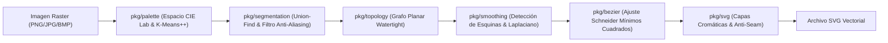

# Vectorizador

> **Motor de vectorización de imágenes raster (PNG, JPG, BMP) a SVG de alta precisión en Go puro.**  

[Repositorio en GitHub](https://github.com/zamora322/vectorizador)

[](https://go.dev/)
[]()
[]()
[]()
[]()

---

## Tabla de Contenidos

- [Características Principales](#características-principales)
- [Arquitectura Algorítmica](#arquitectura-algorítmica)
- [Preservación de Transparencia y Eliminación de Halos (Fringe)](#preservación-de-transparencia-y-eliminación-de-halos-fringe)
- [Instalación y Requisitos](#instalación-y-requisitos)
- [Modo de Uso: Asistente Web (Studio Wizard)](#modo-de-uso-asistente-web-studio-wizard)
- [Suite de Edición Interactiva de Segmentos](#suite-de-edición-interactiva-de-segmentos)
- [Modo de Uso: Línea de Comandos (CLI)](#modo-de-uso-línea-de-comandos-cli)
- [Endpoints de la API HTTP y WebSocket](#endpoints-de-la-api-http-y-websocket)
- [Batería de Pruebas y Rendimiento](#batería-de-pruebas-y-rendimiento)
- [Estructura del Proyecto](#estructura-del-proyecto)
- [Licencia](#licencia)

---

## Características Principales

- **100% Go Puro:** Sin dependencias externas pesadas, sin CGo, sin Python y sin dependencias de ImageMagick o librerías de sistema.
- **Cuantificación Cromática Perceptual y Auto-Detección de Colores:** Detección automática del número óptimo de colores dominantes en el espacio uniforme **CIE $L^*a^*b^*$** mediante análisis de histograma y distancias $\Delta E$ (CIEDE / CIE76), con inicialización K-Means++ y ajuste manual interactivo.
- **Preservación Nativa de Transparencia y Des-premultiplicación:** Soporte completo de canal alpha sin introducir halos oscuros (*fringe*) en los bordes. El fondo transparente original se conserva intacto en la salida SVG.
- **Filtro Anti-Aliasing (SubPixel):** Algoritmo inteligente que identifica y elimina las franjas intermedias falsas producidas por el suavizado de bordes raster entre regiones de alto contraste.
- **Grafo Topológico Watertight (Hermético):** Trazado celular en cuadrícula dual de celdas unitarias. Las formas adyacentes comparten exactamente los mismos nodos de frontera, eliminando huecos, grietas y solapamientos.
- **Detección de Esquinas Vivas:** Preservación de vértices con ángulo agudo ($\theta \ge 60^\circ$) combinada con suavizado Laplaciano de alta fidelidad sub-píxel.
- **Ajuste de Curvas Bézier por Mínimos Cuadrados:** Implementación del algoritmo de Schneider con subdivisión recursiva de segmentos según tolerancia de curvatura.
- **Generación SVG con Trazo Anti-Seam:** Emisión de polígonos agrupados por capa de color con compensación de renderizado `stroke-width="0.09375"` para evitar artefactos de rasterizado.
- **Exportación Multiformato Vectorial & CAD (SVG, EPS, PDF, DXF):**
  - **SVG:** Gráficos vectoriales estándar W3C con capas cromáticas y soporte de transparencia.
  - **EPS:** PostScript 3.0 con diccionario de macros (`/er`, `/sc`, `/ct`) y metadatos de capa Adobe Illustrator (`%AI5_BeginLayer`) para Illustrator, CorelDRAW e imprenta profesional.
  - **PDF:** Documento vectorial estándar PDF 1.4 autónomo con compresión Flate/zlib nativa y curvas Bézier exactas.
  - **DXF:** Formato AutoCAD 2000 (`AC1015`) con entidades `LWPOLYLINE` cerradas y capas TrueColor/ACI optimizadas para corte láser, CNC, fresadoras y plotters de vinilo.
- **Suite de Edición Interactiva en Vivo:** Herramientas flotantes de retoque sobre el canvas con mapeo sub-píxel 1:1 e historial de **Deshacer y Rehacer** (`Ctrl+Z`, `Ctrl+Y`):
  - **Mano (Pan) / Zoom:** Paneo libre y zoom continuo centrado en el cursor (de 5% a 3000%).
  - **Cubo de Pintura (Recolor):** Reasignación instantánea de color activo o transparencia nativa con un clic.
  - **Fusión de Segmentos (Merge):** Unificación de regiones contiguas con dos clics.
  - **Borrador a Transparente (Erase):** Conversión de segmentos a fondo alfa instantáneo.
  - **Zap Tool (Destruir Artefacto):** Algoritmo que destruye un segmento de ruido y redistribuye sus píxeles hacia los vecinos perimetrales más afines en espacio $\text{CIE } L^*a^*b^*$ ($\Delta E$).
  - **Lápiz / Pincel Corrector:** Trazo libre interactivo en tiempo real sobre el lienzo con rasterizador de disco y selector de grosor dinámico (`1px`, `2px`, `4px`, `8px`) para separar formas o conectar trazos cortados.
- **Selector de Paletas Rápidas:** Fila de tarjetas de 1-clic con combinaciones candidatas precalculadas ($K \in [2, 3, 4, 6, 8, 12, 16]$), muestras visuales de color y distintivo `★ Óptima` sincronizado bidireccionalmente con el deslizador numérico.
- **Rendimiento Multi-Core Ultra-Rápido (160x en Cuantización, 9.2x Global):**
  - Cuantización cromática paralela por franjas horizontales entre todos los núcleos del CPU (`runtime.GOMAXPROCS`).
  - Acceso directo a memoria nativa `PixOffset` sin llamadas virtuales por píxel.
  - Caché L1 directo de 24-bits con validación exacta RGB (**100% matemática exacta, cero pérdida de calidad ni aproximación**).
  - Volcado de previsualización `ToRGBA()` directo a memoria lineal contigua.
- **Mapeo Sub-Píxel 1:1 y Aislamiento Estricto de Eventos:** Proyección sin distorsión de coordenadas del cursor al espacio nativo de la imagen y aislamiento completo del lienzo para evitar clics accidentales desde el panel de ajustes o cabecera.
- **Doble Interfaz:**
  - **CLI:** Ideal para automatización en scripts y procesamiento por lotes en servidores.
  - **Asistente Web (Studio):** Interfaz gráfica unificada en una sola ventana con dock flotante de iconos vectoriales SVG.

---

## Arquitectura Algorítmica



### Correspondencia de Módulos

| Paquete Go | Responsabilidad |
| :--- | :--- |
| [`pkg/palette`](pkg/palette) | Conversión sRGB $\leftrightarrow$ Lab, $\Delta E$ y K-Means++ | 
| [`pkg/segmentation`](pkg/segmentation) | Conectividad 4-conexa, absorción de ruido, rechazo AA, preservación alfa y mutaciones interactivas |
| [`pkg/topology`](pkg/topology) | Red celular planar con aristas orientadas herméticas |
| [`pkg/smoothing`](pkg/smoothing) | Esquinas vivas y relajación de contornos |
| [`pkg/bezier`](pkg/bezier) | Subdivisión recursiva y ajuste Bézier cúbico |
| [`pkg/exporter`](pkg/exporter) | Exportación multiformato (SVG, EPS, PDF, DXF) |
| [`pkg/svg`](pkg/svg) | Bucles SVG agrupados con trazo `0.09375pt` |
| [`pkg/server`](pkg/server) | Servidor HTTP multipart, WebSockets, pila Undo/Redo y assets embebidos |
| [`cmd/vectorizador`](cmd/vectorizador) | Punto de entrada binario dual (CLI y `serve`) |

---

## Preservación de Transparencia y Eliminación de Halos (Fringe)

Uno de los desafíos clásicos en vectorización de gráficos es la pérdida del canal alfa y la aparición de coronas oscuras alrededor de siluetas (*dark halos* o *color fringe*). El motor implementa una solución integral:

1. **Detección Nativa de Alpha:**
   - Todo píxel con valor alfa $A < 128 \times 257$ se identifica directamente como `Transparent: true` y se le asigna `ColorIndex: -1`.
   - Se descarta de la inicialización de K-Means++, impidiendo que los píxeles vacíos contaminen los centros cromáticos con tonos negros o grisáceos artificiales.

2. **Des-premultiplicación de Color (Anti-Halo):**
   - El modelo estándar de Go `image.Image.At().RGBA()` devuelve canales R, G, B premultiplicados por alfa en el rango $[0, 65535]$.
   - Al calcular la distancia en píxeles semi-transparentes ($64 \le A < 65535$), el motor revierte la premultiplicación mediante la fórmula:
     $$R_{real} = \frac{R_{prem} \times 65535}{A}, \quad G_{real} = \frac{G_{prem} \times 65535}{A}, \quad B_{real} = \frac{B_{prem} \times 65535}{A}$$
   - Esto recupera los verdaderos colores perimetrales y erradica los halos oscuros que deforman logos vectorizados.

3. **Inmunidad en Absorción y Filtrado:**
   - La etapa de filtrado de ruido (`filterSmallSegments`) prohíbe que segmentos opacos válidos sean absorbidos por la región transparente externa, salvaguardando detalles finos y trazos delgados.

4. **Emisión Vectorial Limpia en SVG:**
   - Las regiones con `Transparent: true` se omiten durante la generación de elementos `<path>`, de modo que el SVG resultante no incluye rectángulos opacos de fondo y se integra con transparencia nativa sobre cualquier diseño o web.

5. **Soporte en la Suite Interactiva:**
   - La paleta del frontend detecta automáticamente la existencia de zonas transparentes y genera una muestra especial punteada (`∅ Transparente`).
   - El Cubo de Pintura permite seleccionar dicha muestra para convertir cualquier segmento en transparente con un clic.
   - El Borrador convierte las zonas señaladas en fondo alfa de forma instantánea.

---

## Instalación y Requisitos

### Requisitos Previos
* **Go 1.22 o superior** instalado en el sistema.

### Compilación desde el Código Fuente
```bash
# Clonar o situarse en el repositorio
cd /home/zamora322/Documentos/Code/vectorizador

# Descargar módulos mínimos
go mod tidy

# Compilar el binario ejecutable
go build -o vectorizador ./cmd/vectorizador
```

### Instalar en el Sistema (Opcional)
Para tener el comando `vectorizador` disponible globalmente en la terminal:
```bash
# Opción 1: Enlace simbólico a ~/.local/bin (recomendado)
mkdir -p ~/.local/bin
ln -sf $(pwd)/vectorizador ~/.local/bin/vectorizador

# Opción 2: go install
go install ./cmd/vectorizador
```

---

## Modo de Uso: Asistente Web (Studio Wizard)

El asistente web proporciona una experiencia guiada paso a paso:

```bash
vectorizador serve -port 8080
```

1. **Apertura Automática:** Se abrirá tu navegador en `http://localhost:8080`.
2. **Subida Confiable:** Arrastra cualquier archivo PNG, JPG o BMP (incluso imágenes grandes de alta resolución de hasta 64 MB) a la zona de carga o haz clic en las muestras de calibración detectadas en `testdata/`.
3. **Flujo de 4 Pasos Interactivo:**
   * **Paso 1: Paleta de Colores:** El motor detecta automáticamente la cantidad de colores dominantes de la imagen cargada y calibra el deslizador. El usuario puede reducir o aumentar libremente el número de colores (de 2 a 24). La paleta K-Means++ en espacio CIE $L^*a^*b^*$ se actualiza dinámicamente.
   * **Paso 2: Segmentación:** Activa o desactiva el rechazo de anti-aliasing y calibra el umbral de tamaño mínimo de segmento para fusionar ruido.
   * **Paso 3: Suavizado & Curvas:** Modifica el nivel de suavizado Laplaciano, preserva o libera esquinas vivas ($\theta \ge 60^\circ$) y ajusta la tolerancia de nodos Bézier.
   * **Paso 4: Exportación:** Activa la compensación *anti-seam*, visualiza el SVG renderizado con selector de capas o fondo transparente, y descarga el archivo SVG o cópialo al portapapeles.
4. **Notificaciones sin Espera Infinita:** Difusión de etapas por WebSocket (*K-Means*, *Segmentación*, *Topología*, *Bézier*, *SVG*) y un banner superior de errores que alerta de cualquier eventualidad de forma inmediata sin bloquear la interfaz.

---

## Suite de Edición Interactiva de Segmentos

Durante la visualización de la imagen, dispones de una **barra flotante de herramientas** sobre el visor:

| Herramienta | Atajo de Teclado | Acción |
| :--- | :--- | :--- |
| **Mover (Pan)** | `H` / Espacio + Arrastre | Arrastra el lienzo para desplazarte con libertad. |
| **Cubo de Pintura** | `C` / `B` | Selecciona un color de la paleta (o Transparente) y haz clic para reasignarlo al instante. |
| **Fusión de Segmentos** | `L` / `M` | Haz clic en el primer segmento y luego en el contiguo para unificarlos en una sola región continua. |
| **Borrador a Transparente** | `E` | Haz clic en cualquier segmento para convertirlo en fondo transparente nativo. |
| **Zap Tool (Destruir)** | `Z` | Haz clic en un segmento de ruido/artefacto para destruirlo y redistribuirlo a los vecinos más afines en Lab $\Delta E$. |
| **Lápiz / Pincel** | `P` | Dibuja trazos libres interactivos con previsualización en vivo para separar regiones o conectar trazos cortados. |
| **Grosor del Lápiz** | Clic en pill `2px` | Alterna dinámicamente entre `1px`, `2px`, `4px` y `8px` de grosor de trazo. |
| **Deshacer** | `Ctrl+Z` | Revierte la última acción de edición utilizando el historial en RAM del motor en Go. |
| **Rehacer** | `Ctrl+Y` | Re-aplica la acción deshecha. |
| **Zoom Continuo** | Rueda del ratón / Botones `+`, `-`, `Reset` | Zoom centrado exactamente en la posición del puntero del ratón (de 5% a 3000%). |

### Mapeo de Coordenadas Sub-Píxel 1:1
* La interfaz utiliza un escenario absoluto sin distorsión por *letterboxing* o escalado CSS.
* Cada clic en pantalla se traduce a la coordenada entera exacta en el espacio nativo de la imagen raster:
  $$(x_{nat}, y_{nat}) = \left\lfloor\frac{x_{rel}}{\text{scale}}\right\rfloor$$
* Un indicador visual tipo *ripple* confirma de inmediato la coordenada precisa donde impactó el clic.
* El motor en Go re-vectoriza la topología afectada en **menos de 30 ms** sin re-ejecutar el costoso agrupamiento K-Means.

---

## Modo de Uso: Línea de Comandos (CLI)

El modo CLI permite procesar imágenes de forma instantánea y automatizada desde la terminal o scripts de integración.

### Sintaxis
```bash
vectorizador -i <imagen_entrada> -o <archivo_salida.svg> [opciones]
```

### Ejemplos de Uso

```bash
# 1. Modo Canónico: Logo con bordes suavizados (Anti-Aliased) - Calidad Media recomendada
vectorizador -i logo.png -mode logo_aa -quality medium -o logo.svg

# 2. Modo Canónico: Pixel Art o bordes nítidos sin anti-aliasing - Calidad Alta (1:1 píxel)
vectorizador -i sprite.png -mode logo_sharp -quality high -o sprite.svg

# 3. Modo Canónico: Fotografía / Tonos continuos (sin esquinas artificiales)
vectorizador -i retrato.jpg -mode photo -quality high -format all

# 4. Exportación a DXF para máquinas de corte láser o fresadoras CNC
vectorizador -i plantilla.png -mode logo_sharp -o corte.dxf

# 5. Generar simultáneamente todos los formatos (SVG, EPS, PDF, DXF)
vectorizador -i logo.png -format all

# 6. Isotipo con fondo transparente y ajuste fino de colores
vectorizador -i icono.png -mode logo_aa -colors 4 -transparent-bg -o icono.svg
```

### Opciones y Parámetros CLI

| Bandera | Tipo | Valor por Defecto | Descripción |
| :--- | :--- | :--- | :--- |
| `-i` | `string` | *(requerido)* | Ruta al archivo de imagen raster de entrada (PNG, JPG, BMP). |
| `-o` | `string` | `"output.svg"` | Ruta donde se guardará el archivo (`.svg`, `.eps`, `.pdf`, `.dxf`). |
| `-mode` | `string` | `"logo_aa"` | Modo canónico: `logo_aa` (suavizado), `logo_sharp` (nítido / pixel), `photo` (fotografía). |
| `-quality` | `string` | `"medium"` | Preset de calidad / complejidad: `high` (alta), `medium` (media), `low` (baja). |
| `-format` | `string` | `""` | Formatos a emitir: `svg`, `eps`, `pdf`, `dxf`, `all` (o lista separada por comas). |
| `-colors` | `int` | `8` | Número de colores de paleta a cuantificar (entre 2 y 24, `0` para auto-detección). |
| `-min-pixels` | `int` | `4` | Tamaño mínimo de segmento en píxeles. Regiones menores se absorben. |
| `-reject-aa` | `bool` | `true` | Rechaza artefactos y franjas intermedias de anti-aliasing. |
| `-smoothness` | `float` | `0.5` | Factor de suavizado de contornos (de `0.0` nulo a `1.0` máximo). |
| `-corners` | `bool` | `true` | Detecta y preserva esquinas vivas en vértices agudos ($\ge 60^\circ$). |
| `-anti-seam` | `bool` | `true` | Aplica trazo compensatorio `0.09375pt` para sellar uniones en SVG. |
| `-transparent-bg` | `bool` | `false` | Omite el color de fondo para exportar un SVG con fondo transparente. |

---

## Los 3 Modos Canónicos y Matriz de Presets de Calidad

Vectorizador implementa la jerarquía canónica de procesamiento, adaptando automáticamente la tubería matemática sin obligar al usuario a calibrar manualmente cada número:

| Modo Canónico | Categoría de Entrada | Esquinas Vivas | Filtro Anti-Aliasing | Preset Calidad | Píxeles Mín. | Suavizado | Tolerancia Curva |
| :--- | :--- | :---: | :---: | :--- | :---: | :---: | :---: |
| **`logo_aa`** | Artwork con bordes mezclados / suavizados | **Sí** ($\ge 60^\circ$) | **Activo** | **Alta**<br>**Media** *(Default)*<br>**Baja** | 2 px<br>4 px<br>8 px | 0.35<br>0.50<br>0.75 | 0.50 px<br>0.75 px<br>1.25 px |
| **`logo_sharp`** | Pixel art, logos nítidos, capturas sin mezcla | **Sí** ($\ge 60^\circ$) | **Inactivo** (Preserva píxeles) | **Alta** (1:1 Pixel)<br>**Media** *(Default)*<br>**Baja** | 1 px<br>2 px<br>6 px | 0.10<br>0.25<br>0.45 | 0.25 px<br>0.50 px<br>0.85 px |
| **`photo`** | Fotografías, retratos, curvas continuas | **No** (Curvas orgánicas fluidas) | **Inactivo** (Gradientes reales) | **Alta** (Textura)<br>**Media** *(Default)*<br>**Baja** (Póster) | 3 px<br>8 px<br>20 px | 0.30<br>0.50<br>0.75 | 0.40 px<br>0.75 px<br>1.30 px |

---

## Endpoints de la API HTTP y WebSocket

El servidor integrado expone una API REST y WebSocket ligera:

| Método | Endpoint | Descripción |
| :--- | :--- | :--- |
| `POST` | `/api/upload` | Carga de archivos por `multipart/form-data` (hasta 64 MB). Acepta parámetro opcional `config` en JSON y devuelve el SVG, paleta, segmentación y candidatos. |
| `GET` | `/api/samples` | Devuelve una lista JSON con las imágenes presentes en `testdata/`. |
| `POST` | `/api/samples/load?name=<archivo>` | Carga y procesa directamente una muestra del disco sin retransmitir base64. |
| `GET` | `/api/samples/<archivo>` | Sirve la imagen original de muestra en formato PNG. |
| `GET` | `/api/palettes/suggest` | Devuelve las paletas candidatas precalculadas ($K \in [2, 3, 4, 6, 8, 12, 16]$) con la insignia `is_optimal`. |
| `POST` | `/api/segments/edit` | Endpoint REST para mutaciones directas de segmentos (`recolor`, `merge`, `erase`, `zap`, `pencil`, `undo`, `redo`). |
| `GET` | `/api/export?format=...` | Descarga directa de archivos en formato `svg`, `eps`, `pdf` o `dxf` con cabeceras `Content-Disposition`. |
| `WS` | `/ws` | Canal WebSocket bidireccional para eventos de progreso en tiempo real, re-procesamiento de sliders y mutación de segmentos en vivo. |

---

## Batería de Pruebas y Rendimiento

El proyecto cuenta con cobertura de pruebas unitarias sobre todos los paquetes críticos:

```bash
go test -v ./...
```

### Resultados de Calibración en `testdata/`

| Imagen de Prueba | Resolución | Píxeles | Tiempo de Vectorización | Tamaño SVG | Notas |
| :--- | :--- | :--- | :--- | :--- | :--- |
| [`logo_sharp.png`](testdata/logo_sharp.png) | 120 x 120 | 14,400 | **~12 ms** | 4.1 KB | Esquinas vivas a 90° nítidas. |
| [`logo_aa.png`](testdata/logo_aa.png) | 160 x 160 | 25,600 | **~18 ms** | 8.5 KB | Rechazo de bordes de anti-aliasing. |
| [`curved_shape.png`](testdata/curved_shape.png) | 200 x 100 | 20,000 | **~16 ms** | 5.8 KB | Ajuste fluido de ondas y curvas. |
| [`6.png`](testdata/6.png) | 2327 x 1157 | 2,692,339 | **~1.6 s** *(antes ~14.9s)* | 1.68 MB | Aceleración multi-núcleo 9.2x y cuantización 160x. |

---

## Estructura del Proyecto

```text
vectorizador/
├── cmd/
│   └── vectorizador/          # Punto de entrada de la aplicación CLI y servidor
│       └── main.go
├── pkg/
│   ├── bezier/                # Ajuste de curvas Bézier cúbicas por mínimos cuadrados
│   │   ├── curve.go
│   │   ├── fit.go
│   │   └── fit_test.go
│   ├── engine/                # Orquestador del pipeline end-to-end con progreso
│   │   ├── engine.go
│   │   └── engine_test.go
│   ├── exporter/              # Exportador multiformato vectorial y CAD (SVG, EPS, PDF, DXF)
│   │   ├── document.go        # Modelo unificado VectorDocument
│   │   ├── dxf.go             # AutoCAD 2000 AC1015 con LWPOLYLINE
│   │   ├── eps.go             # PostScript 3.0 con macros y capas AI
│   │   ├── export.go          # Dispatcher unificado y MIME types
│   │   ├── exporter_test.go   # Pruebas con gs, pdfinfo e inkscape
│   │   ├── pdf.go             # PDF 1.4 nativo con compresión zlib
│   │   └── svg.go             # Emisor SVG
│   ├── palette/               # Espacio CIE L*a*b*, Delta E y K-Means++
│   │   ├── color.go
│   │   ├── palette.go
│   │   └── palette_test.go
│   ├── segmentation/          # Componentes conexas Union-Find, rechazo AA y edición
│   │   ├── alpha_test.go      # Pruebas unitarias de transparencia y anti-halo
│   │   ├── antialiasing.go
│   │   ├── edit.go            # Recolor, Merge, Erase y Clone atómicos
│   │   ├── edit_test.go       # Pruebas unitarias de edición
│   │   ├── segment.go
│   │   └── segment_test.go
│   ├── server/                # Servidor HTTP/WebSocket y assets web embebidos
│   │   ├── server.go
│   │   └── web/               # Copia sincronizada para //go:embed
│   ├── smoothing/             # Detección de esquinas vivas y suavizado Laplaciano
│   │   ├── corners.go
│   │   ├── smoother.go
│   │   └── smoother_test.go
│   ├── svg/                   # Generación de archivos SVG watertight
│   │   ├── writer.go
│   │   └── writer_test.go
│   └── topology/              # Grafo planar de celdas duales herméticas
│       ├── graph.go
│       ├── tracer.go
│       └── tracer_test.go
├── testdata/                  # Imágenes de calibración y verificación
│   ├── 6.png
│   ├── curved_shape.png
│   ├── logo_aa.png
│   └── logo_sharp.png
├── web/                       # Código fuente de la interfaz web (Vanilla HTML5/JS/CSS)
│   ├── app.js
│   ├── index.html
│   └── style.css
├── go.mod
├── go.sum
└── README.md
```

---

## Licencia

Este proyecto está bajo la Licencia **MIT**. Consulta el código fuente para más detalles.
