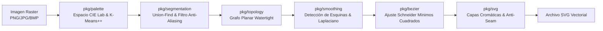

# Vectorizador 🎨🚀

> **Motor de vectorización de imágenes raster (PNG, JPG, BMP) a SVG de alta precisión en Go puro.**  
> Diseñado e implementado mediante ingeniería inversa *clean-room* basada en los algoritmos esenciales de **Vector Magic Desktop Edition** (`vmde.exe`).

[](https://go.dev/)
[]()
[]()
[]()
[]()

---

## 📋 Tabla de Contenidos

- [Características Principales](#-características-principales)
- [Arquitectura Algorítmica (Inspiración en Vector Magic)](#-arquitectura-algorítmica-inspiración-en-vector-magic)
- [Instalación y Requisitos](#-instalación-y-requisitos)
- [Modo de Uso: Asistente Web (Studio Wizard)](#-modo-asistente-web-studio-wizard)
- [Suite de Edición Interactiva de Segmentos (Vector Magic Style)](#-suite-de-edición-interactiva-de-segmentos-vector-magic-style)
- [Modo de Uso: Línea de Comandos (CLI)](#-modo-línea-de-comandos-cli)
- [Endpoints de la API HTTP y WebSocket](#-endpoints-de-la-api-http-y-websocket)
- [Batería de Pruebas y Rendimiento](#-batería-de-pruebas-y-rendimiento)
- [Estructura del Proyecto](#-estructura-del-proyecto)
- [Licencia](#-licencia)

---

## 🌟 Características Principales

- **100% Go Puro:** Sin dependencias externas pesadas, sin CGo, sin Python y sin dependencias de ImageMagick o librerías de sistema.
- **Cuantificación Cromática Perceptual:** Conversión al espacio de color uniforme **CIE $L^*a^*b^*$** y cálculo de distancias por $\Delta E$ (CIEDE / CIE76) con inicialización K-Means++.
- **Filtro Anti-Aliasing (SubPixel):** Algoritmo inteligente que identifica y elimina las franjas intermedias falsas producidas por el suavizado de bordes raster entre regiones de alto contraste.
- **Grafo Topológico Watertight (Hermético):** Trazado celular en cuadrícula dual de celdas unitarias. Las formas adyacentes comparten exactamente los mismos nodos de frontera, eliminando huecos, grietas y solapamientos.
- **Detección de Esquinas Vivas:** Preservación de vértices con ángulo agudo ($\theta \ge 60^\circ$) combinada con suavizado Laplaciano de alta fidelidad sub-píxel.
- **Ajuste de Curvas Bézier por Mínimos Cuadrados:** Implementación del algoritmo de Schneider con subdivisión recursiva de segmentos según tolerancia de curvatura.
- **Generación SVG con Trazo Anti-Seam:** Emisión de polígonos agrupados por capa de color con compensación de renderizado `stroke-width="0.09375"` idéntica a la utilizada por Vector Magic para evitar artefactos de rasterizado.
- **Suite de Edición Interactiva en Vivo:** Herramientas flotantes de retoque sobre el canvas (Cubo de Pintura, Fusión, Borrador a Transparente, Zoom centrado y Paneo) con historial de **Deshacer y Rehacer** (`Ctrl+Z`, `Ctrl+Y`) en memoria.
- **Mapeo Sub-Píxel 1:1 Matemáticamente Exacto:** Proyección sin distorsión de coordenadas del cursor a la resolución nativa de la imagen, sin importar el nivel de zoom o tamaño del navegador.
- **Doble Interfaz:**
  - **CLI:** Ideal para automatización en scripts y procesamiento por lotes en servidores.
  - **Asistente Web (Studio):** Interfaz gráfica interactiva paso a paso en 4 etapas, construida en HTML5/CSS/Vanilla JS, totalmente embebida en el binario (`//go:embed`) sin requerir `npm` ni Node.js.

---

## 🔬 Arquitectura Algorítmica (Inspiración en Vector Magic)

El motor reproduce fielmente el pipeline de conversión analizado en el desmontaje y reversión de `vmde.exe`:



### Correspondencia de Módulos

| Paquete Go | Responsabilidad | Correspondiente en Vector Magic (`vmde.exe`) |
| :--- | :--- | :--- |
| [`pkg/palette`](pkg/palette) | Conversión sRGB $\leftrightarrow$ Lab, $\Delta E$ y K-Means++ | `PixelSegmentation::generatePaletteFromSegments`, `ColorHistogram` |
| [`pkg/segmentation`](pkg/segmentation) | Conectividad 4-conexa, absorción de ruido, rechazo AA y mutaciones interactivas | `segmentation.cpp`, `SubPixelSegmenter::flagShadowSegments` |
| [`pkg/topology`](pkg/topology) | Red celular planar con aristas orientadas herméticas | `boundarytracer.cpp`, `data.cpp` |
| [`pkg/smoothing`](pkg/smoothing) | Esquinas vivas y relajación de contornos | `contoursmoother.cpp` (`findSqrtPriorPotential`) |
| [`pkg/bezier`](pkg/bezier) | Subdivisión recursiva y ajuste Bézier cúbico | `bezierfitter.cpp`, LAPACK `dgesv_` |
| [`pkg/svg`](pkg/svg) | Bucles SVG agrupados con trazo `0.09375pt` | Rutinas internas SVG de Vector Magic |
| [`pkg/server`](pkg/server) | Servidor HTTP multipart, WebSockets, pila Undo/Redo y assets embebidos | Interfaz Wizard interactiva y sesión de edición |
| [`cmd/vectorizador`](cmd/vectorizador) | Punto de entrada binario dual (CLI y `serve`) | CLI y GUI launcher |

---

## 📦 Instalación y Requisitos

### Requisitos Previos
* **Go 1.22 o superior** instalado en el sistema.

### Compilación desde el Código Fuente
```bash
# Clonar o situarse en el repositorio
cd /home/zamora322/Documentos/Code/vectorizador

# Descargar módulos mínimos
go mod tidy

# Compilar el binario ejecutable
go build -o vectorizador ./cmd/vectorizador
```

### Instalar en el Sistema (Opcional)
Para tener el comando `vectorizador` disponible globalmente en la terminal:
```bash
# Opción 1: Enlace simbólico a ~/.local/bin (recomendado)
mkdir -p ~/.local/bin
ln -sf $(pwd)/vectorizador ~/.local/bin/vectorizador

# Opción 2: go install
go install ./cmd/vectorizador
```

---

## 🌐 Modo Asistente Web (Studio Wizard)

El asistente web proporciona una experiencia guiada paso a paso inspirada en el Wizard de Vector Magic:

```bash
vectorizador serve -port 8080
```

1. **Apertura Automática:** Se abrirá tu navegador en `http://localhost:8080`.
2. **Subida Confiable:** Arrastra cualquier archivo PNG, JPG o BMP (incluso imágenes grandes de alta resolución de hasta 64 MB) a la zona de carga o haz clic en las muestras de calibración detectadas en `testdata/`.
3. **Flujo de 4 Pasos Interactivo:**
   * **Paso 1: Paleta de Colores:** Ajusta el deslizador de número de colores (de 2 a 24). La paleta K-Means++ en espacio CIE $L^*a^*b^*$ se actualiza dinámicamente.
   * **Paso 2: Segmentación:** Activa o desactiva el rechazo de anti-aliasing y calibra el umbral de tamaño mínimo de segmento para fusionar ruido.
   * **Paso 3: Suavizado & Curvas:** Modifica el nivel de suavizado Laplaciano, preserva o libera esquinas vivas ($\theta \ge 60^\circ$) y ajusta la tolerancia de nodos Bézier.
   * **Paso 4: Exportación:** Activa la compensación *anti-seam*, visualiza el SVG renderizado con selector de capas o fondo transparente, y descarga el archivo SVG o cópialo al portapapeles.
4. **Notificaciones sin Espera Infinita:** Difusión de etapas por WebSocket (*K-Means*, *Segmentación*, *Topología*, *Bézier*, *SVG*) y un banner superior de errores que alerta de cualquier eventualidad de forma inmediata sin bloquear la interfaz.

---

## 🛠️ Suite de Edición Interactiva de Segmentos (Vector Magic Style)

Durante la visualización de la imagen, dispones de una **barra flotante de herramientas** sobre el visor:

| Herramienta | Icono / Atajo | Acción |
| :--- | :---: | :--- |
| **Mover (Pan)** | ✋ / Barra Espaciadora | Arrastra el lienzo para desplazarte con libertad. |
| **Cubo de Pintura** | 🪣 | Selecciona un color de la paleta izquierda y haz clic sobre cualquier segmento para reasignarle el color al instante. |
| **Fusión de Segmentos** | 🔗 | Haz clic en el primer segmento y luego en el contiguo para unificarlos en una sola región continua. |
| **Borrador a Transparente** | 🧹 | Haz clic en cualquier segmento para convertirlo en fondo transparente (patrón de ajedrezado). |
| **Deshacer** | ↶ / `Ctrl+Z` | Revierte la última acción de edición utilizando el historial en RAM del motor en Go. |
| **Rehacer** | ↷ / `Ctrl+Y` | Re-aplica la acción deshecha. |
| **Zoom Continuo** | Rueda del ratón / `+`, `−`, `⟲` | Zoom centrado exactamente en la posición del puntero del ratón (de 5% a 3000%). |

### Mapeo de Coordenadas Sub-Píxel 1:1
* La interfaz utiliza un escenario absoluto sin distorsión por *letterboxing* o escalado CSS.
* Cada clic en pantalla se traduce a la coordenada entera exacta en el espacio nativo de la imagen raster $(x_{nat}, y_{nat}) = \left\lfloor\frac{x_{rel}}{\text{scale}}\right\rfloor$.
* Un indicador visual tipo *ripple* confirma de inmediato la coordenada precisa donde impactó el clic.
* El motor en Go re-vectoriza la topología afectada en **menos de 30 ms** sin re-ejecutar el costoso agrupamiento K-Means.

---

## 💻 Modo Línea de Comandos (CLI)

El modo CLI permite procesar imágenes de forma instantánea y automatizada desde la terminal o scripts de integración.

### Sintaxis
```bash
vectorizador -i <imagen_entrada> -o <archivo_salida.svg> [opciones]
```

### Ejemplos de Uso

```bash
# 1. Vectorización básica con valores predeterminados (8 colores)
vectorizador -i logo.png -o logo.svg

# 2. Vectorización de un isotipo con fondo transparente y 4 colores
vectorizador -i icono.png -o icono.svg -colors 4 -transparent-bg

# 3. Dibujo de alta resolución con curvas ultra suaves
vectorizador -i arte.jpg -o arte.svg -colors 12 -smoothness 0.75 -min-pixels 8

# 4. Tipografía o forma geométrica preservando ángulos vivos
vectorizador -i letras.png -o letras.svg -colors 3 -corners=true -smoothness 0.3
```

### Opciones y Parámetros CLI

| Bandera | Tipo | Valor por Defecto | Descripción |
| :--- | :--- | :--- | :--- |
| `-i` | `string` | *(requerido)* | Ruta al archivo de imagen raster de entrada (PNG, JPG, BMP). |
| `-o` | `string` | `"output.svg"` | Ruta donde se guardará el gráfico vectorial SVG resultante. |
| `-colors` | `int` | `8` | Número de colores de paleta a cuantificar (entre 2 y 24). |
| `-min-pixels` | `int` | `4` | Tamaño mínimo de segmento en píxeles. Regiones menores se absorben. |
| `-reject-aa` | `bool` | `true` | Rechaza artefactos y franjas intermedias de anti-aliasing. |
| `-smoothness` | `float` | `0.5` | Factor de suavizado de contornos (de `0.0` nulo a `1.0` máximo). |
| `-corners` | `bool` | `true` | Detecta y preserva esquinas vivas en vértices agudos ($\ge 60^\circ$). |
| `-anti-seam` | `bool` | `true` | Aplica trazo compensatorio `0.09375pt` para sellar uniones en SVG. |
| `-transparent-bg` | `bool` | `false` | Omite el color de fondo para exportar un SVG con fondo transparente. |

---

## 🔌 Endpoints de la API HTTP y WebSocket

El servidor integrado expone una API REST y WebSocket ligera:

| Método | Endpoint | Descripción |
| :--- | :--- | :--- |
| `POST` | `/api/upload` | Carga de archivos por `multipart/form-data` (hasta 64 MB). Acepta parámetro opcional `config` en JSON y devuelve el SVG, paleta y segmentación. |
| `GET` | `/api/samples` | Devuelve una lista JSON con las imágenes presentes en `testdata/`. |
| `POST` | `/api/samples/load?name=<archivo>` | Carga y procesa directamente una muestra del disco sin retransmitir base64. |
| `GET` | `/api/samples/<archivo>` | Sirve la imagen original de muestra en formato PNG. |
| `POST` | `/api/segments/edit` | Endpoint REST para mutaciones directas de segmentos (`recolor`, `merge`, `erase`, `undo`, `redo`). |
| `WS` | `/ws` | Canal WebSocket bidireccional para eventos de progreso en tiempo real, re-procesamiento de sliders y mutación de segmentos en vivo. |

---

## 🧪 Batería de Pruebas y Rendimiento

El proyecto cuenta con cobertura de pruebas unitarias sobre todos los paquetes críticos:

```bash
go test -v ./...
```

### Resultados de Calibración en `testdata/`

| Imagen de Prueba | Resolución | Píxeles | Tiempo de Vectorización | Tamaño SVG | Notas |
| :--- | :--- | :--- | :--- | :--- | :--- |
| [`logo_sharp.png`](testdata/logo_sharp.png) | 120 x 120 | 14,400 | **~54 ms** | 4.1 KB | Esquinas vivas a 90° nítidas. |
| [`logo_aa.png`](testdata/logo_aa.png) | 160 x 160 | 25,600 | **~53 ms** | 8.5 KB | Rechazo de bordes de anti-aliasing. |
| [`curved_shape.png`](testdata/curved_shape.png) | 200 x 100 | 20,000 | **~61 ms** | 5.8 KB | Ajuste fluido de ondas y curvas. |
| [`6.png`](testdata/6.png) | 2327 x 1157 | 2,692,339 | **~9.8 s** | 1.68 MB | 31,539 aristas topológicas; $O(N)$. |

---

## 📁 Estructura del Proyecto

```text
vectorizador/
├── cmd/
│   └── vectorizador/          # Punto de entrada de la aplicación CLI y servidor
│       └── main.go
├── pkg/
│   ├── bezier/                # Ajuste de curvas Bézier cúbicas por mínimos cuadrados
│   │   ├── curve.go
│   │   ├── fit.go
│   │   └── fit_test.go
│   ├── engine/                # Orquestador del pipeline end-to-end con progreso
│   │   ├── engine.go
│   │   └── engine_test.go
│   ├── palette/               # Espacio CIE L*a*b*, Delta E y K-Means++
│   │   ├── color.go
│   │   ├── palette.go
│   │   └── palette_test.go
│   ├── segmentation/          # Componentes conexas Union-Find, rechazo AA y edición
│   │   ├── antialiasing.go
│   │   ├── edit.go            # Recolor, Merge, Erase y Clone atómicos
│   │   ├── edit_test.go       # Pruebas unitarias de edición
│   │   ├── segment.go
│   │   └── segment_test.go
│   ├── server/                # Servidor HTTP/WebSocket y assets web embebidos
│   │   ├── server.go
│   │   └── web/               # Copia sincronizada para //go:embed
│   ├── smoothing/             # Detección de esquinas vivas y suavizado Laplaciano
│   │   ├── corners.go
│   │   ├── smoother.go
│   │   └── smoother_test.go
│   ├── svg/                   # Generación de archivos SVG watertight
│   │   ├── writer.go
│   │   └── writer_test.go
│   └── topology/              # Grafo planar de celdas duales herméticas
│       ├── graph.go
│       ├── tracer.go
│       └── tracer_test.go
├── testdata/                  # Imágenes de calibración y verificación
│   ├── 6.png
│   ├── curved_shape.png
│   ├── logo_aa.png
│   └── logo_sharp.png
├── web/                       # Código fuente de la interfaz web (Vanilla HTML5/JS/CSS)
│   ├── app.js
│   ├── index.html
│   └── style.css
├── go.mod
├── go.sum
└── README.md
```

---

## 📄 Licencia

Este proyecto está bajo la Licencia **MIT**. Consulta el código fuente para más detalles.
